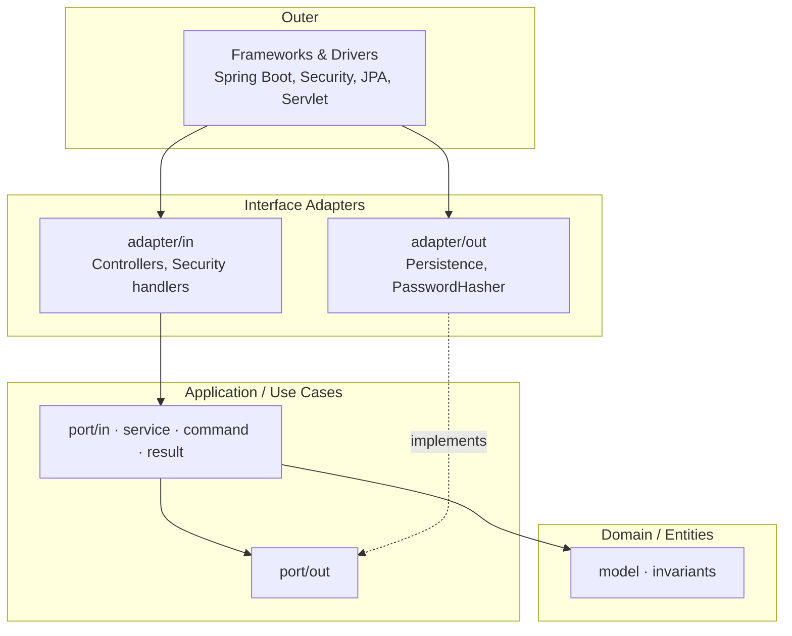
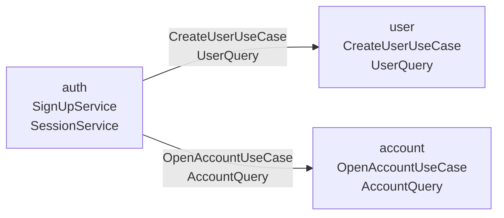

# Clean Sliced Onion — Broker

This broker is organized as a **sliced onion**: each business module (`user`, `account`, `auth`) has its own Clean / Onion layers.

```text
Dependencies point inward (toward Domain / Use Cases).

Application
│
├── user/          Domain → Application → Adapters
├── account/       Domain → Application → Adapters
└── auth/          Application → Adapters   (no domain of its own)
```

## Module map

| Module | Owns | Docs |
|---|---|---|
| [user](user.md) | Identity: email, name, password hash | Full onion with domain |
| [account](account.md) | Trading accounts | Full onion with domain |
| [auth](auth.md) | Signup, login/logout, session | Thin onion (application + adapters) |

## Global dependency rule



## Cross-module communication

Modules talk only through **exposed application ports**, never through another module’s domain or persistence.



Signup consistency boundary: `SignUpService` creates the user and opens a Regular account in **one transaction**.

## Terminology (cheat sheet)

| Term | Meaning | Example |
|---|---|---|
| **Port in** | Interface: “what can you ask this module to do?” | `SignUpUseCase`, `UserQuery`, `AccountQuery` |
| **Port out** | Interface: “what does this module need from outside?” | `UserRepository`, `PasswordHasher` |
| **Adapter in** | Outside drives the app (HTTP / Security → use case) | `AuthController`, `CustomUserDetailsService` |
| **Adapter out** | App drives outside (use case → DB / BCrypt) | `UserPersistenceAdapter`, `SpringPasswordHasher` |
| **Command** | Use-case **input** (application DTO, not HTTP) | `SignUpCommand`, `CreateUserCommand` |
| **Result** | Use-case **output** (application DTO, not HTTP) | `UserView`, `SessionView`, `AccountView` |
| **Request / Response** | HTTP DTOs only (adapter/web) | `RegisterRequest`, `RegisterResponse` |
| **Application service** | Hub: implements port in; calls domain + port out | `SignUpService`, `CreateUserService` |
| **Domain entity** | Business rules on the model | `User`, `Account` |
| **Domain service** | Rules that don’t fit one entity — **none in this codebase yet** | — |

### Call direction

```text
Adapter in → Port in → Application service
                              ├──► Domain (entity)
                              └──► Port out → Adapter out
```

Same technology can appear on both sides: e.g. `adapter/in/security` (Security calls us) vs `adapter/out/security` (we call BCrypt).
