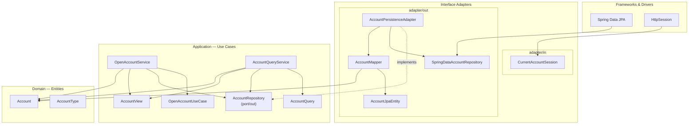

# Account module — Clean Onion

Owns trading accounts: ownership, type, name, selection in the HTTP session.

```text
account/
├── domain/model/
├── application/
│   ├── port/in/
│   ├── port/out/
│   ├── result/
│   └── service/
└── adapter/
    ├── in/web/
    └── out/persistence/
```

## Layer diagram with classes



## Class placement

| Layer | Package | Classes |
|---|---|---|
| Domain | `account.domain.model` | `Account`, `AccountType` |
| Application (in) | `account.application.port.in` | `OpenAccountUseCase`, `AccountQuery` |
| Application (out) | `account.application.port.out` | `AccountRepository` |
| Application | `account.application.result` | `AccountView` |
| Application | `account.application.service` | `OpenAccountService`, `AccountQueryService` |
| Adapter in | `account.adapter.in.web` | `CurrentAccountSession` |
| Adapter out | `account.adapter.out.persistence` | `AccountPersistenceAdapter`, `AccountJpaEntity`, `SpringDataAccountRepository`, `AccountMapper` |

## Notes

- `Account.openRegular` and `Account.ensureOwnedBy` protect invariants in the domain.
- `CurrentAccountSession` is a web adapter (stores selected account id in `HttpSession`). Auth’s web/security adapters depend on it deliberately.
- There is no account REST controller yet; accounts are opened during signup and selected during login/session.
