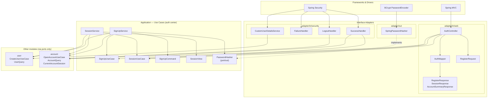

# Auth module — Clean Onion (thin)

Auth has **no domain package**. Its center is the **application / use-case** layer. It coordinates `user` and `account` through their public ports.

```text
auth/
├── application/
│   ├── port/in/
│   ├── port/out/
│   ├── command/
│   ├── result/
│   └── service/
└── adapter/
    ├── in/web/        HTTP → use cases
    ├── in/security/   Spring Security → use cases (login/logout/load user)
    └── out/security/  use cases → BCrypt (PasswordHasher)
```

Same Spring Security stack, opposite directions: **in** = Security calls us; **out** = we call hashing.

## Layer diagram with classes



## Class placement

| Layer | Package | Classes |
|---|---|---|
| Domain | — | *(none — no auth entities)* |
| Application (in) | `auth.application.port.in` | `SignUpUseCase`, `SessionUseCase` |
| Application (out) | `auth.application.port.out` | `PasswordHasher` |
| Application | `auth.application.command` | `SignUpCommand` |
| Application | `auth.application.result` | `SessionView` |
| Application | `auth.application.service` | `SignUpService`, `SessionService` |
| Adapter in (web) | `auth.adapter.in.web` | `AuthController`, `AuthMapper`, `RegisterRequest`, `RegisterResponse`, `SessionResponse`, `AccountSummaryResponse` |
| Adapter in (security) | `auth.adapter.in.security` | `SuccessHandler`, `FailureHandler`, `LogoutHandler`, `CustomUserDetailsService` |
| Adapter out | `auth.adapter.out.security` | `SpringPasswordHasher` |

## Onion shape vs user/account

```text
user / account:     adapter → application → domain
auth:               adapter → application  →  (ports of user & account)
```

## Flows

**Signup**

```text
POST /api/auth/signup
  → AuthController → SignUpCommand
  → SignUpService
       → PasswordHasher.hash
       → CreateUserUseCase.create
       → OpenAccountUseCase.openRegularAccount
  → RegisterResponse
```

**Login**

```text
POST /api/auth/login  (Spring Security form login)
  → CustomUserDetailsService → UserQuery.findCredentialsByEmail
  → SuccessHandler → SessionUseCase.startSession
  → CurrentAccountSession.set(default account id)
```

**Session**

```text
GET /api/auth/session
  → AuthController reads CurrentAccountSession
  → SessionUseCase.resolveSession
  → SessionResponse
```
