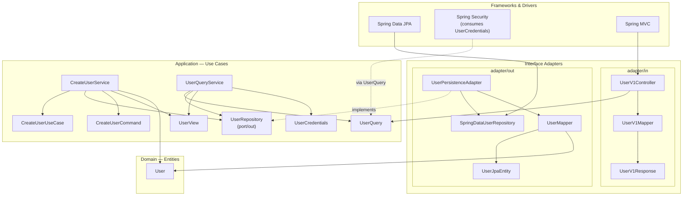

# User module — Clean Onion

Owns people: identity, email, password hash.

```text
user/
├── domain/model/
├── application/
│   ├── port/in/
│   ├── port/out/
│   ├── command/
│   ├── result/
│   └── service/
└── adapter/
    ├── in/web/v1/
    └── out/persistence/
```

## Layer diagram with classes



## Class placement

| Layer | Package | Classes |
|---|---|---|
| Domain | `user.domain.model` | `User` |
| Application (in) | `user.application.port.in` | `CreateUserUseCase`, `UserQuery` |
| Application (out) | `user.application.port.out` | `UserRepository` |
| Application | `user.application.command` | `CreateUserCommand` |
| Application | `user.application.result` | `UserView`, `UserCredentials` |
| Application | `user.application.service` | `CreateUserService`, `UserQueryService` |
| Adapter in | `user.adapter.in.web.v1` | `UserV1Controller`, `UserV1Mapper`, `UserV1Response` |
| Adapter out | `user.adapter.out.persistence` | `UserPersistenceAdapter`, `UserJpaEntity`, `SpringDataUserRepository`, `UserMapper` |

## Runtime flows

**Create user** (called by auth signup):

```text
CreateUserUseCase.create(CreateUserCommand)
  → User.register(...)
  → UserRepository.save
  → UserPersistenceAdapter → SpringDataUserRepository → users table
  → UserView
```

**Query /me**:

```text
GET /api/v1/users/me
  → UserV1Controller
  → UserQuery.getByEmail
  → UserV1Mapper → UserV1Response
```
