# Spring Security form login

Default servlet form login (`http.formLogin()`), CSRF on, session cookie. Framework blueprint for Spring Security 6 and 7. Sample values in the later pages use `username=ada` and `password=secret`.

`POST /login` is authenticated and answered by the success handler. That request never enters the controller. The browser then sends the session cookie on a new request, and that request is the one that reaches the controller.

## Login request

```http
POST /login HTTP/1.1
Content-Type: application/x-www-form-urlencoded

username=ada&password=secret&_csrf=token-from-the-login-page
```

`UsernamePasswordAuthenticationFilter` reads `username` and `password`. The CSRF token was stored when the login page was rendered.

## Authentication request

The login filter builds this object and passes it to `AuthenticationManager.authenticate`. It is not trusted yet.

```text
UsernamePasswordAuthenticationToken
  authenticated: false
  principal:     "ada"
  credentials:   "secret"
  authorities:   empty
  details:       WebAuthenticationDetails
```

After `DaoAuthenticationProvider` succeeds, `ProviderManager` returns a different token. The principal is the `UserDetails`, and `eraseCredentials()` has set the raw password to null.

```text
UsernamePasswordAuthenticationToken
  authenticated: true
  principal:     UserDetails ("ada", stored hash, ROLE_USER)
  credentials:   null
  authorities:   [ROLE_USER, FACTOR_PASSWORD]
  details:       same WebAuthenticationDetails
```

## From the browser to the controller

`DisableEncodeUrlFilter`, `WebAsyncManagerIntegrationFilter`, and `HeaderWriterFilter` run first on both requests. They do not decide login or authorization.

```mermaid
flowchart TD
    A["Browser<br/>POST /login<br/>username + password + _csrf"]
    B["Tomcat"]
    C["DelegatingFilterProxy"]
    D["FilterChainProxy<br/>DefaultSecurityFilterChain"]
    E["SecurityContextHolderFilter<br/>deferred empty context"]
    F["CsrfFilter<br/>_csrf matches"]
    G["LogoutFilter<br/>URL is not /logout"]
    H["UsernamePasswordAuthenticationFilter<br/>POST /login matches"]
    I["Authentication request<br/>unauthenticated token"]
    J["ProviderManager"]
    K["DaoAuthenticationProvider<br/>UserDetailsService + PasswordEncoder"]
    L["Authenticated token<br/>credentials erased"]
    M["ChangeSessionIdAuthenticationStrategy"]
    N["SecurityContextImpl on this thread"]
    O["HttpSession<br/>SPRING_SECURITY_CONTEXT"]
    P["Success handler<br/>Set-Cookie: JSESSIONID<br/>filter returns, chain stops"]

    Q["Browser<br/>GET /<br/>Cookie: JSESSIONID"]
    R["Tomcat"]
    S["DelegatingFilterProxy"]
    T["FilterChainProxy"]
    U["SecurityContextHolderFilter<br/>load SPRING_SECURITY_CONTEXT"]
    V["CsrfFilter<br/>GET, continue"]
    W["LogoutFilter<br/>continue"]
    X["UsernamePasswordAuthenticationFilter<br/>not POST /login, continue"]
    Y["RequestCacheAwareFilter<br/>continue"]
    Z["SecurityContextHolderAwareRequestFilter<br/>exposes getUserPrincipal"]
    ZA["AnonymousAuthenticationFilter<br/>already authenticated, continue"]
    ZB["ExceptionTranslationFilter<br/>continue"]
    ZC["AuthorizationFilter<br/>authenticated, continue"]
    ZD["DispatcherServlet"]
    ZE["HandlerMapping"]
    ZF["Controller"]

    A --> B --> C --> D --> E --> F --> G --> H --> I --> J --> K --> L
    L --> M --> N --> O --> P --> Q
    Q --> R --> S --> T --> U --> V --> W --> X --> Y --> Z --> ZA --> ZB --> ZC --> ZD --> ZE --> ZF
```



The second request's `Authentication` is the one stored in the session. `request.getUserPrincipal()` in the controller is that same object.

## Pages

1. [DelegatingFilterProxy to FilterChainProxy](01-delegating-filter-proxy.md)
2. [SecurityContextHolderFilter](02-security-context-holder-filter.md)
3. [CsrfFilter](03-csrf-filter.md)
4. [LogoutFilter](04-logout-filter.md)
5. [UsernamePasswordAuthenticationFilter](05-username-password-authentication-filter.md)
6. [AuthenticationManager to ProviderManager](06-provider-manager.md)
7. [DaoAuthenticationProvider](07-dao-authentication-provider.md)
8. [UserDetailsService](08-user-details-service.md)
9. [PasswordEncoder](09-password-encoder.md)
10. [ChangeSessionIdAuthenticationStrategy](10-change-session-id-strategy.md)
11. [SecurityContext](11-security-context.md)
12. [DelegatingSecurityContextRepository](12-delegating-security-context-repository.md)
13. [HttpSessionSecurityContextRepository](13-http-session-security-context-repository.md)
14. [RequestAttributeSecurityContextRepository](14-request-attribute-security-context-repository.md)
15. [AuthenticationSuccessHandler](15-authentication-success-handler.md)
16. [AuthenticationFailureHandler](16-authentication-failure-handler.md)
17. [AuthorizationFilter](17-authorization-filter.md)
