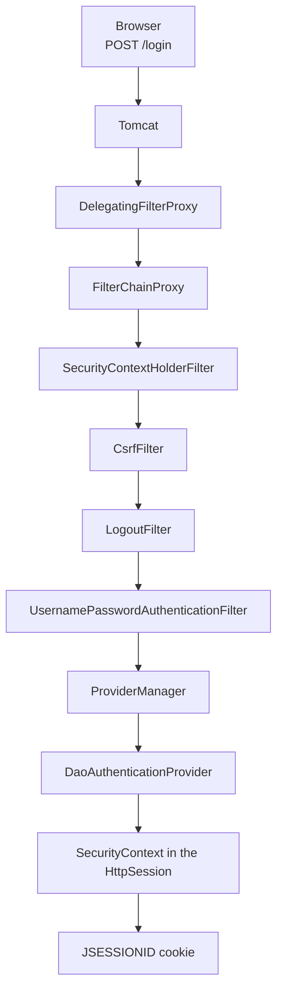

# Spring Security form login

Default servlet form login (`http.formLogin()`), CSRF on, session cookie. Framework blueprint for Spring Security 6 and 7. Sample values in the later pages use `username=ada` and `password=secret`.

```http
POST /login HTTP/1.1
Content-Type: application/x-www-form-urlencoded

username=ada&password=secret&_csrf=token-from-the-login-page
```

`UsernamePasswordAuthenticationFilter` reads `username` and `password`. The CSRF token was stored when the login page was rendered.



Read in this order. Each page is one handoff.

1. [DelegatingFilterProxy to FilterChainProxy](01-delegating-filter-proxy.md)
2. [SecurityContextHolderFilter](02-security-context-holder-filter.md)
3. [CsrfFilter](03-csrf-filter.md)
4. [LogoutFilter](04-logout-filter.md)
5. [UsernamePasswordAuthenticationFilter](05-username-password-authentication-filter.md)
6. [AuthenticationManager to ProviderManager](06-provider-manager.md)
7. [DaoAuthenticationProvider](07-dao-authentication-provider.md)
8. [UserDetailsService](08-user-details-service.md)
9. [PasswordEncoder](09-password-encoder.md)
10. [ChangeSessionIdAuthenticationStrategy](10-change-session-id-strategy.md)
11. [SecurityContext](11-security-context.md)
12. [DelegatingSecurityContextRepository](12-delegating-security-context-repository.md)
13. [HttpSessionSecurityContextRepository](13-http-session-security-context-repository.md)
14. [RequestAttributeSecurityContextRepository](14-request-attribute-security-context-repository.md)
15. [AuthenticationSuccessHandler](15-authentication-success-handler.md)
16. [AuthenticationFailureHandler](16-authentication-failure-handler.md)
17. [AuthorizationFilter](17-authorization-filter.md)

`DisableEncodeUrlFilter`, `WebAsyncManagerIntegrationFilter`, and `HeaderWriterFilter` run before `SecurityContextHolderFilter`. They do not decide login.
